# Ermo

Um jogo escrito em **assembly ARM64** (AArch64), virando um **RPG de ação** estilo Diablo 2 num planeta inteiro (pixel art no estilo do Terraria, na visão isométrica de hoje).

> **Em transformação.** O jogo de sobrevivência com a vila (3 famílias, tarefas, zonas, casas, depósitos) está guardado na etiqueta `vila` do git (`git checkout vila` para jogar). Daqui para a frente o Ermo vira um RPG, etapa por etapa; por enquanto sobrou a parte de sobrevivência, com você sozinho.

Você chega sozinho num mundo gerado aleatoriamente: terreno contínuo, mar, praias, florestas, montanhas com neve. Precisa coletar madeira, pedra e frutas, caçar com arco e flecha, pescar, plantar trigo, fabricar ferramentas e construções, fugir de lobos e ursos, não morrer de fome e passar a noite perto de uma fogueira (ou dormindo numa cabana), enfrentando as estações e o clima (chuva, tempestade, calorão, neve, granizo, enchente). Quanto mais você faz uma coisa, melhor fica nela, e para se curar precisa estar de barriga cheia.

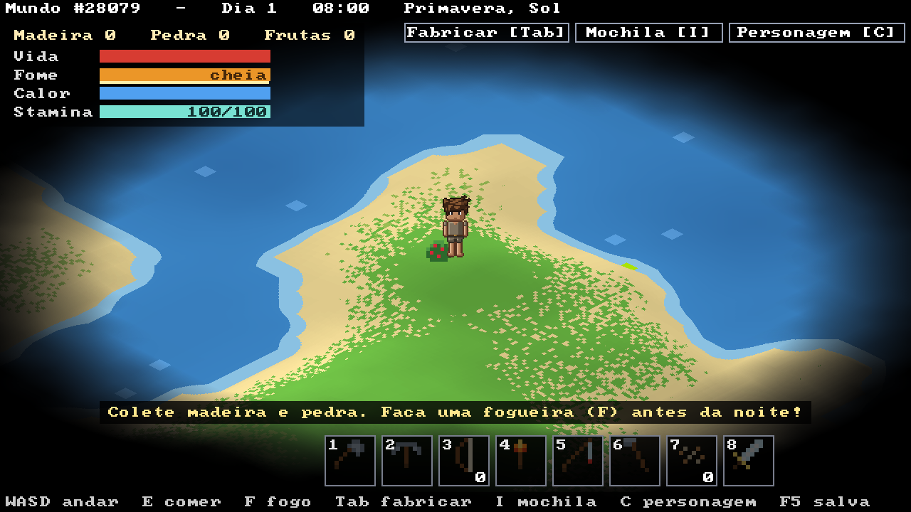
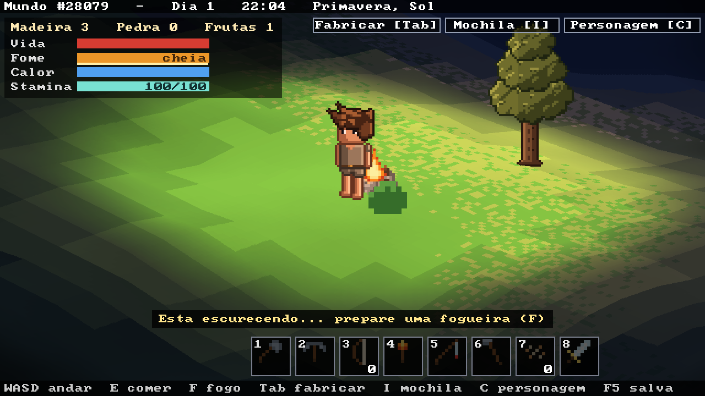

**Pixel art (em andamento):** o herói, o lobo, as árvores, os pinheiros e as pedras já são os desenhos do designer (`design/estilo/designer/ermo_estilo.json`, pixel art no estilo do Terraria). O herói é desenhado em **camadas** nas 8 direções, respirando parado: com a **armadura** na mochila aparecem o peitoral e o capacete (o cabelo fica curto embaixo dele), com a **roupa de couro**, as botas, e com a **espada** na mão, a espada. O zoom vai em passos inteiros (1 pixel do desenho = 1, 2, 3 ou 4 pixels na tela) e nada é suavizado. De noite a luz é **por bloco**: cada célula recebe um nível de luz em degraus de 1/8, e o fogo e os olhos dos lobos brilham no escuro. O **chão** também é do designer: cada célula é um losango de 32 × 16 (grama em 4 variações, floresta, campo seco, areia, rocha, neve, água rasa e funda, estrada, terra arada, caminho e buraco de pedreira), escolhido pela célula inteira, então as bordas seguem os losangos. O relevo continua contínuo (os degraus de penhasco vêm na fase do planeta). Os outros desenhos (arbustos, bichos, construções, interface) ainda são os antigos.

**As construções** (desenho do designer, em `design/estruturas/estruturas.json`) estão em isométrica, com volume, na mesma resolução do personagem: fogueira com chama animada (e as cinzas quando apaga, que somem em 1 dia), baú que abre, abrigo, cerca que liga nos vizinhos, portão que **abre quando você passa**, fornalha que acende quando você está do lado, lampião aceso de noite e as pilhas no chão em 3 tamanhos (pouco, metade, cheia). De noite, a chama e o vidro do lampião não escurecem.

## Como jogar

| Tecla / mouse | Ação |
|---|---|
| ENTER | entrar no mundo (na tela de título); se tiver jogo salvo daquele mundo, continua ele |
| C / N | na tela de título: continua o jogo salvo / começa um jogo novo no mundo mostrado |
| F5 | salva o jogo (em `ermo.sav`, na pasta do jogo) |
| F9 | carrega o jogo salvo (também na tela de título e depois de morrer) |
| WASD / setas | andar |
| Shift (segurando) | correr |
| segurar o botão esquerdo | coletar a árvore, pedra ou arbusto sob o mouse (até 3 células de distância) |
| E | comer (o que encher mais primeiro: carne assada, pão, frutas assadas, peixe assado...) |
| F | fabricar uma fogueira e escolher onde montar |
| Tab ou botão **Fabricar** | abre a janela de fabricar |
| clique no mapa (com uma construção na mão) | coloca a construção num quadrado da grade; botão direito ou ESC cancela |
| 1 / 2 / 3 | põe na mão o machado, a picareta ou o arco (de novo: mãos vazias) |
| 4 | põe ou tira a tocha da outra mão |
| 5 | põe na mão a vara de pesca |
| 6 / 7 | põe na mão a enxada / as sementes |
| 8 | põe na mão a espada |
| segurar o botão esquerdo com a enxada | ara a grama sob o mouse (passe por várias células) |
| segurar o botão esquerdo com sementes | planta na terra arada sob o mouse |
| arrastar com cercas na mão | prévia da fileira na grade (horizontal, vertical ou diagonal); soltar coloca |
| clique na água com a vara na mão | lança a linha; quando aparecer "Peixe! Clique!", clique para fisgar |
| clique com o arco na mão | atira uma flecha onde está o mouse |
| clique num animal perto | golpe (machado tira mais vida) |
| botão direito num baú (a até 4 células) | abre o baú (clique num item passa de um lado para o outro) |
| botão direito no abrigo (depois das 18h) | dorme até amanhecer (qualquer tecla acorda) |
| botão direito numa fogueira | pôr lenha (+2 min de fogo; no máximo 12 min) |
| I ou botão **Mochila** | abre a mochila (clique num item: come, põe na mão, coloca ou guarda no baú aberto) |
| C ou botão **Personagem** | abre as skills |
| botão direito num item da mochila | larga 1 no chão (com Shift: a pilha toda) |
| roda do mouse / `+` / `-` | zoom |
| espaço | pausa |
| F11 | tela cheia (liga/desliga); a janela também pode ser redimensionada |
| F10 | modo leve: desenha metade das colunas do terreno (para computadores lentos ou emulados) |
| G | liga/desliga a grade no chão |
| N | curvas de nível |
| ESC | fecha janelas, cancela a construção ou volta ao menu |

**Recursos**

- **Árvores e pinheiros:** 4 madeiras cada; somem quando acabam.
- **Pedreiras:** a pedra vem em manchas de 3 x 3 a 5 x 5 células (chão cinza), com 12 a 19 pedras em cada célula; muitas nas colinas e montanhas, raras no campo. Quando uma célula acaba, vira um **buraco de cascalho**. Fora delas há poucas pedras soltas (3 cada).
- **Arbustos:** poucos e espalhados, com 2 frutas; demoram uns **3 dias** para dar frutas de novo (com chuva, metade) e no inverno não dão.

**Fabricar (Tab)**

Como no Minecraft e no Factorio, uma grade de ícones mostra tudo o que dá para fazer.

- Ícone apagado: falta material. Borda verde: dá para fazer.
- Passando o mouse por cima de uma receita, aparecem o nome, o custo (verde ou vermelho) e o que ela faz.
- Fabricar é instantâneo.
- Construções vão para a mochila e entram direto no modo de colocar: aparece uma prévia no mouse (piscando onde não dá) e você clica no chão, até 5 células do personagem.

| Receita | Custo | O que faz |
|---|---|---|
| Machado | 3 madeira, 2 pedra | na mão: corta árvores 2x mais rápido; dura 40 madeiras |
| Picareta | 3 madeira, 3 pedra | na mão: quebra pedras 2x mais rápido; dura 40 pedras |
| Arco | 5 madeira | na mão: atira flechas |
| Flechas (4) | 1 madeira, 1 pedra | munição do arco (somem ao acertar) |
| Tocha | 2 madeira | na outra mão: acende sozinha quando escurece; luz forte e visão de 10 células por 4 minutos |
| Fogueira | 5 madeira, 3 pedra | luz e calor por 4 minutos (construção) |
| Baú | 8 madeira | guarda itens sem pesar na mochila (construção) |
| Abrigo | 12 madeira, 4 pedra | cabana: dentro dela não passa frio, e dá para dormir a noite toda (construção) |
| Frutas assadas | 3 frutas, perto de uma fogueira | enchem 50 de fome |
| Carne assada | 1 carne, perto de uma fogueira | enche 60 de fome (crua: só 10) |
| Cesto | 6 madeira | +10 kg no limite da mochila (só um conta) |
| Roupa de couro | 4 couro | metade do frio (noite, água e clima) |
| Mochila de couro | 3 couro, 2 madeira | +20 kg no limite (soma com o cesto) |
| Cercas (4) | 2 madeira | ninguém passa: nem animais, nem você (construção, arrasta em linha) |
| Portão | 4 madeira | você passa, os animais não (construção; pode trocar uma cerca) |
| Vara de pesca | 3 madeira, 2 frutas | na mão: pesca na água |
| Peixe assado | 1 peixe, perto de uma fogueira | enche 40 de fome (cru: só 8) |
| Enxada | 2 madeira, 1 pedra | na mão: ara a terra para plantar; dura 40 usos |
| Pão | 3 trigo, perto de uma fogueira | enche 45 de fome |
| Fornalha | 10 pedra, 4 madeira | perto dela (3 células) aparecem as receitas de ferro (construção) |
| Barra de ferro | 2 minério, 1 carvão, perto da fornalha | o material do ferro |
| Carvão | 3 madeira, perto da fornalha | carvão de madeira (o mineral sai dos veios) |
| Machado de ferro | 3 ferro, 2 madeira | o machado (1) fica **4x** mais rápido que sem; dura 120 árvores; golpe 4 |
| Picareta de ferro | 3 ferro, 2 madeira | pedras e veios 4x mais rápido; dura 120 |
| Enxada de ferro | 2 ferro, 2 madeira | dura 120 usos |
| Espada | 3 ferro, 1 madeira | na mão (8): golpe 6 nos bichos |
| Armadura de ferro | 6 ferro, 2 couro | na mochila: metade do dano das mordidas |
| Lampião | 1 ferro, 1 carvão, 2 madeira | luz a noite inteira (7 células) e visão em volta, sem lenha (construção) |
| Estrada | 1 pedra | piso de paralelepípedos: anda-se **50% mais rápido**. Arraste no mapa como a cerca; as junções (retas, curvas, T, cruz) se ajustam sozinhas. A enxada desfaz e devolve a pedra |

- O desgaste das ferramentas e o tempo da tocha acesa aparecem como uma barrinha embaixo do ícone na mochila. Quando o machado ou a picareta quebra, o próximo (se você tiver) entra novo.
- **Grade:** toda construção fica presa num quadrado da grade (o abrigo ocupa 2 x 2) e só vai num quadrado **livre**: sem nada em cima (árvore, pedra, arbusto, trigo, pilha, baú, fogueira), sem cerca, sem terra arada e fora da água. A grade aparece no chão sozinha quando você está com uma construção, a enxada ou as sementes na mão (mais forte até onde você alcança) e pode ficar sempre ligada com a tecla **G**. O quadrado sob o mouse fica verde (dá), vermelho (não dá) ou laranja (a enxada desfaz a terra).
- Para **desmontar** um baú ou um abrigo, segure o botão esquerdo nele: ele volta para a mochila. O baú precisa estar vazio.

**Dormir**

A cabana tem uma porta do tamanho do personagem.

- Com o **botão direito nela, a partir das 18h**, você entra e dorme.
- A tela escurece, aparece "Zzz..." e o relógio corre: a noite passa em uns 5 segundos.
- Você acorda às 06:00. Se a água subir, se ficar fraco (fome ou frio) ou se você apertar qualquer tecla, acorda antes.
- Dormindo, a fome continua caindo (uns 17 pontos por noite), mas a cabana protege do frio e dos lobos, e a tocha fica apagada.

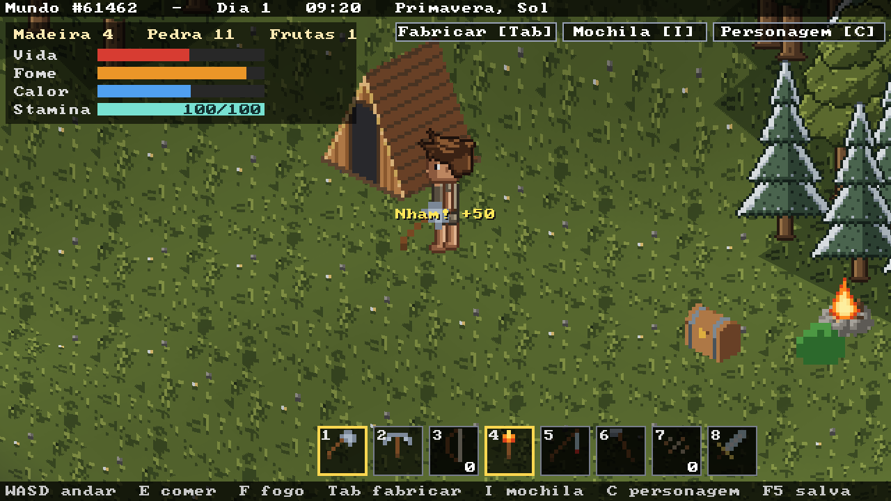
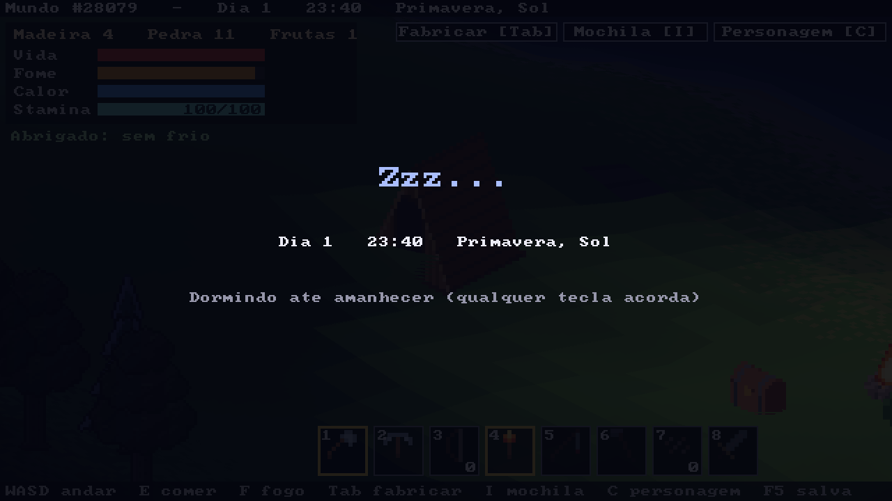

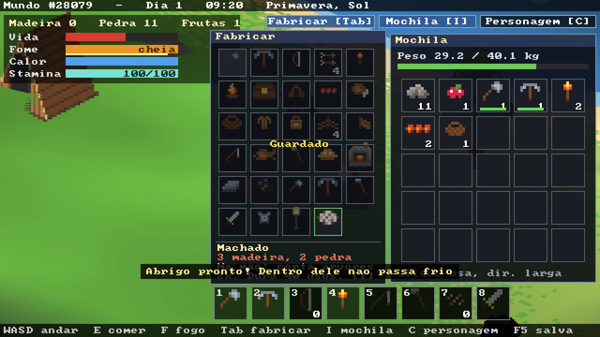
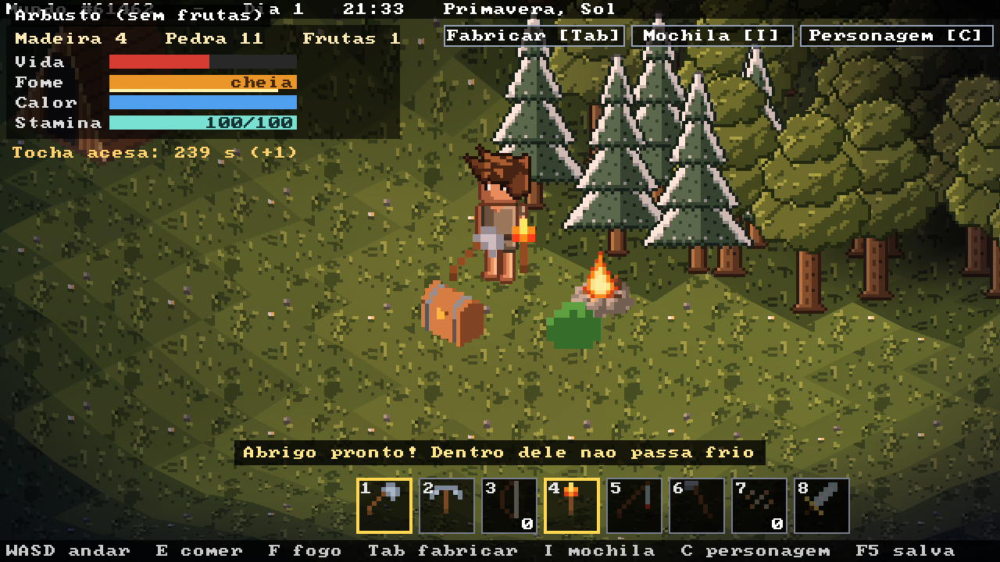

**Na mão**

- Embaixo da tela fica a barra **na mão**: 1 machado, 2 picareta, 3 arco, 4 tocha, 5 vara de pesca, 6 enxada e 7 sementes. O que você segura tem a borda amarela; o número no arco é quantas flechas sobram, e nas sementes, quantas você tem.
- Machado e picareta só ajudam (e só gastam) se estiverem na mão.
- A **tocha** vai na **outra mão**: dá para segurar o arco ou o machado e ainda ter luz à noite. Ela só se gasta quando queima até o fim.

**Animais e caça**

Os animais aparecem longe da vista, cada um no seu terreno, e somem quando ficam muito longe.

| Animal | Onde | Comportamento | Vida | Deixa |
|---|---|---|---|---|
| Coelho | campo | foge rápido | 2 | 1 carne |
| Cervo | floresta e campo úmido | anda em **manada** (3 ou 4) e foge junto | 6 | 2 carne, 2 couro |
| Cabra | colinas, rocha e neve | foge | 5 | 2 carne, 1 couro |
| Caranguejo | praia | anda devagar | 1 | 1 carne |
| Lobo | floresta (de noite, também campo e colinas) | **ataca**: mordida de 8 | 6 | 1 carne, 1 couro |
| Urso | floresta, rocha e neve | **ataca**: mordida de 15 | 14 | 4 carne, 3 couro |

- Os bichos são **poucos** (no máximo 10 por perto) e no **inverno** quase não aparecem bichos de caça.
- Bichos pacíficos fogem quando você chega perto ou quando são feridos. Ferir um cervo espanta a manada toda.
- Lobos e ursos perseguem: de dia só se você chegar perto, de noite de bem mais longe. Um animal ferido fica furioso.
- Correndo (Shift), você escapa de um lobo.
- Nenhum animal entra na água, e os perigosos têm medo de fogo: perto de uma fogueira acesa, ou dentro do abrigo, você está seguro.
- **Flecha** tira 4 de vida. Golpe com machado tira 3, com picareta 2 e com as mãos 1.
- O animal abatido deixa pilhas de **carne** e **couro** no chão; segure o botão esquerdo para recolher.

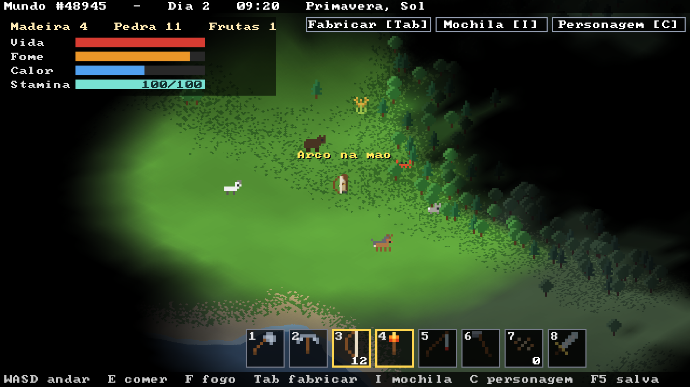

**Cercas e portão**

- Fabrique cercas (4 por 2 madeiras) e clique nelas na mochila para colocar.
- Com cerca ou portão na mão aparece uma **grade** com as células até onde você alcança (8 células), seguindo o relevo.
- **Aperte o botão esquerdo no começo da fileira e arraste.** A prévia trava em 8 direções da tela: horizontal, vertical e as duas diagonais. As células ficam **verdes** onde dá, **vermelhas** onde não dá (água, longe, em cima de você ou sem cerca suficiente) e **brancas** onde já tem cerca. Embaixo aparece quantas cercas a fileira gasta.
- **Solte para colocar** a fileira toda. O botão direito, durante o arraste, cancela só a fileira.
- Na horizontal e na vertical da tela a fileira vira uma **escadinha fechada** (uma célula a mais por degrau): nada passa pela quina.
- Cerca não deixa ninguém passar. O **portão** deixa você passar, mas os animais não. Coloque o portão em cima de uma cerca para trocar (a cerca volta para a mochila).
- Um cercado fechado com você dentro: os lobos ficam do lado de fora a noite toda.
- Para desmontar, segure o botão esquerdo nela, como numa árvore: volta para a mochila.

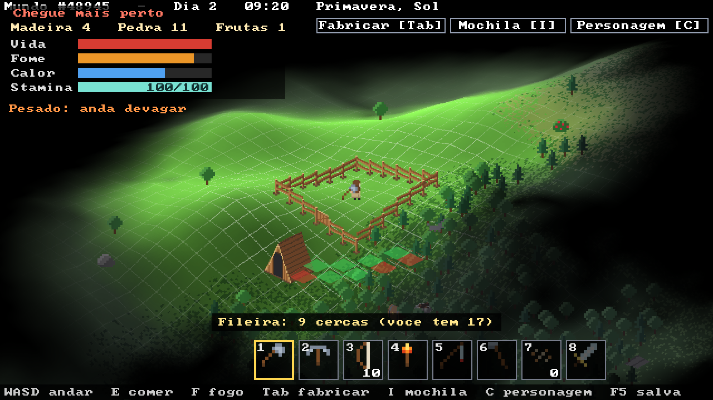

**Pesca**

- Fabrique uma **vara de pesca** (3 madeira, 2 frutas) e aperte **5** para segurar.
- Clique na água (até ~5 células, parado em terra ou na água rasa) para lançar. A boia fica balançando.
- Depois de 4 a 10 segundos o peixe morde: a boia afunda e aparece **"Peixe! Clique!"**. Clique rápido para fisgar; se demorar, ele escapa.
- Clicar antes da mordida recolhe a linha. Andar longe da boia também.

| Água | Peixe | Quantos |
|---|---|---|
| lago | lambari | 1 |
| mar perto da praia | robalo | 1 a 2 |
| mar fundo | atum | 3 |

- Peixe cru enche 8 de fome; **assado** na fogueira, 40.

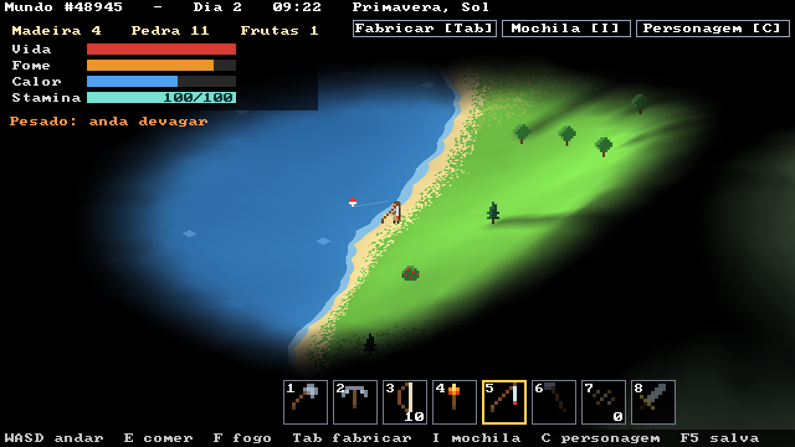

**Ferro**

- Nas **colinas, rocha e neve** algumas manchas são **minas** (chão avermelhado): de **ferro** (pontos laranja, 8 minérios por célula) ou de **carvão** (pontos pretos, 10 por célula). Só quebram com a **picareta na mão** (2). A célula que acaba vira **terra de mina**.
- Monte uma **fornalha** e fique perto dela: **2 minério + 1 carvão = 1 barra de ferro**; sem carvão mineral, **3 madeira = 1 carvão**.
- Com ferro: ferramentas de ferro (as de pedra continuam valendo; a de ferro é usada primeiro e gasta antes), espada, armadura e lampião (veja as receitas).

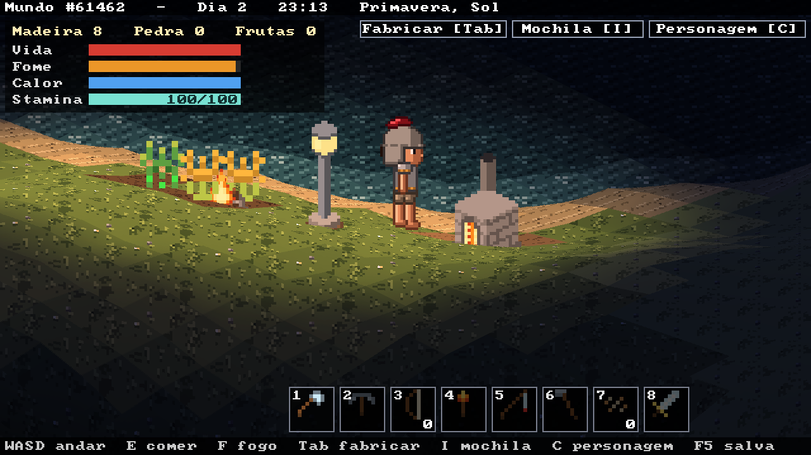

**Plantação** (como no Minecraft)

- No campo aberto nasce, raro, **trigo selvagem** (dourado). Segure o botão esquerdo nele: dá 1 trigo e 1 **semente**.
- Fabrique uma **enxada** (2 madeira, 1 pedra) e aperte **6**. Segure o botão esquerdo e passe o mouse pela grama: cada célula vira **terra arada**, com sulcos. Não dá para arar areia, rocha, neve, água nem onde tem algo em cima.
- Aperte **7** (sementes na mão) e passe pela terra arada para **plantar**.
- O trigo cresce em **4 estágios**, do broto verde até ficar dourado. A dica do mouse mostra quanto já cresceu.
- Colha segurando o botão esquerdo quando estiver **maduro**: 1 trigo e 1 ou 2 sementes. Com sementes na mão, colher e replantar sai num gesto só.
- Plantou, não tira mais: o trigo **verde** não sai, tem que esperar. Só a **enxada** desfaz: passada na terra arada, ela volta a ser grama e a planta verde que estiver ali se perde (com a semente). Numa mesma segurada do botão a enxada só ara ou só desfaz, conforme o que fez primeiro.
- **3 trigos** viram **pão** na fogueira (enche 45 de fome).

| O que acontece | Efeito no crescimento |
|---|---|
| sem nada | maduro em ~1,5 dia de jogo (18 min) |
| água a até 4 quadrados | a terra fica molhada (mais escura) e cresce **2x** mais rápido |
| chuva ou tempestade | 1,5x |
| calorão | metade, se a terra estiver seca |
| outono, inverno ou neve | não cresce (só brota na primavera e no verão) |

- **Coelhos, cervos e cabras** enxergam trigo maduro a até 8 células e vão comer. Uma **cerca** em volta protege a plantação.
- Dormindo, a noite passa depressa e a plantação cresce junto.

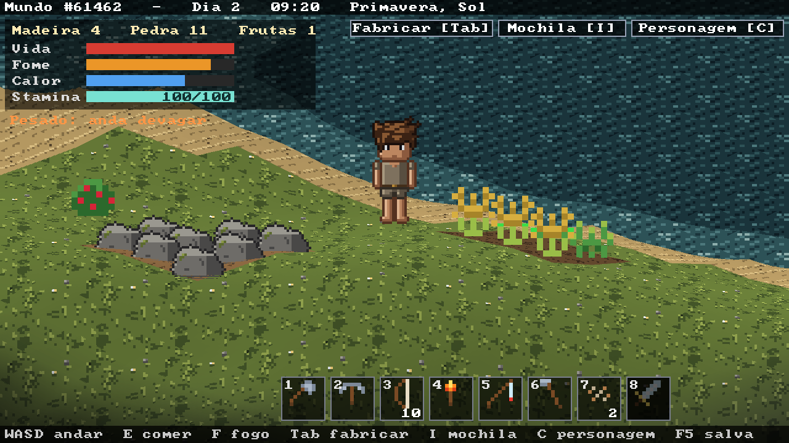

**Nível e experiência**

- Você começa no **nível 1** e ganha **XP** abatendo bichos. O XP é o **nível do bicho** (metade nos pacíficos), ×2 no campeão e ×4 no chefe. Bicho acima do seu nível dá +10% por nível (até +50%); bem abaixo dá menos: 5 a 6 níveis abaixo, 50%; 7 a 9, 25%; 10 ou mais, 10% (sempre pelo menos 1).
- Para subir do nível N para o N+1 são precisos round(10 × 1,25^(N−1)) de XP: 10, 13, 16, 20, 24, 31, 38, 48, 60, 75… (nível 20: 694; nível 40: 60.185). Não tem nível máximo; o XP é guardado em 64 bits.
- O painel mostra **Nv** e a barra roxa de XP (com "atual/precisa"). Ao subir aparece "Você subiu para o nível N!" e o nível pisca em dourado.
- **Janela do personagem (C):** a desenhada pelo designer (pedido 1.0): retrato do herói com o equipamento, nível, barra de XP, os 4 atributos com ícone e botão **+** (acende com o mouse em cima, afunda ao apertar, fica apagado sem pontos), os pontos livres, a vida e a carga. As **skills** ficam num painel na direita (no lugar da mochila: com a mochila aberta, ele some).
- **Barra de XP da tela:** a do designer, sempre visível em cima da barra "na mão", enchendo de roxo. Ao subir de nível, uma **luz dourada** sobe em volta do herói (8 quadros, brilha de noite).
- **Atributos:** Força, Destreza, Vitalidade e Energia, começando em 10. Cada nível dá **5 pontos**: abra a janela **C** e clique no **+** do atributo. Efeitos: **Força** dá **+1 kg** de carga por ponto acima de 10; **Vitalidade** dá vida máxima = 50 + 5 por ponto (100 no começo); **Energia** dá mana máxima = 5 por ponto (50 no começo); a **Destreza** entra no combate (fase 3).
- **Vida e mana:** o painel mostra a vida e a mana com os números ("150/150"). A vida fica guardada em porcentagem: fome e frio tiram a mesma fatia, mas a mordida dos bichos tira pontos de vida, então com mais Vitalidade ela pesa menos. A mana enche sozinha em 30 s (vai ser gasta nas skills, fase 9). Os globos estilo Diablo vêm com a arte da fase de Interface.

**Andar com o mouse (fase 3)**

- **Clique esquerdo no chão** e o personagem anda até lá, como no Diablo; segurando o botão, ele segue o mouse. **WASD** continua funcionando e cancela o clique; **Shift** corre também andando pelo mouse. Ele para ao chegar ou se empacar (água, pedra, cerca). **Clique num bicho longe:** o personagem vai até ele (seguindo se ele andar) e dá o golpe ao chegar; desiste se o bicho sumir ou se não der para chegar. Com o **arco** ou a **vara** na mão, o clique atira ou pesca de onde você está. Clicar numa fogueira, ou no chão com a enxada ou as sementes na mão, faz o que fazia antes.
- **Segurar o botão num bicho:** continua atacando, golpe atrás de golpe (meio segundo entre eles), indo atrás se ele se afastar, até ele morrer ou você soltar.
- **Zona de clique:** vale o desenho inteiro do bicho na tela (com 4 px de folga), não só os pés; se dois se sobrepõem, vale o da frente.

**Inimigos com nível (fase 2)**

- Cada bicho tem um **nível**. Com o mouse em cima aparece, **no topo da tela**, a placa do designer com "Lobo - Nv 3" e a **vida** em vermelho, como no Diablo.
- A **vida** e a **mordida** crescem 20% por nível acima do 1: um lobo de nível 6 tem o dobro da vida e morde com o dobro da força.
- **Defesa:** a cada 4 níveis o bicho tira 1 ponto de cada golpe seu (o golpe mínimo é 1).
- **Nível pela região:** o nível de um bicho é 1 + 1 a cada 16 células de distância de onde a partida começou, mais 0 a 2 de sorte. Perto do começo: 1 a 3; a 64 células: 5 a 7; a 200 células: 13 a 15. (Quando houver cidades, a conta passa a ser a partir da primeira cidade.)

- **Noite:** lobo e urso que nascem de noite têm **+2 níveis** (mais perigo, mais XP); a alcateia da noite também.
- **Invasão de elite:** a cada uns 3 minutos, se você está numa área 5 ou mais níveis abaixo do seu, pode aparecer (1 chance em 3) um grupo de **3 lobos do seu nível**, liderado por um campeão, que vem atrás de você. O aviso aparece na tela.
- **Grupos, campeões e chefes:** lobos vêm em grupos de 2 a 4. Às vezes o líder é um **campeão** (+2 níveis, vida ×1,5, anel azul no chão e placa azul) ou um **chefe** (+4 a +5 níveis, vida ×2, anel dourado, placa dourada e nome próprio, como "Presa Cinzenta"). O urso anda sozinho, mas também pode ser campeão ou chefe ("Garra Velha").
- **Lobo e urso do designer (pedido 2.0):** animados, com parado, andar, atacar logo depois da mordida, levar golpe quando ferido e morrer. O corpo cai e fica 6 s no chão.
- **Sombra:** o herói, o lobo e o urso têm uma sombra oval no chão, que escurece o que está embaixo.

**Sobrevivência**

- **Fome:** quando enche (comendo), fica **cheia por 4 minutos** antes de começar a cair. Comer de novo com ela cheia renova esse tempo. Depois cai de cheia a vazia em uns 16 minutos. Sem comida, a vida cai.
- **Calor:** de dia fica tudo bem. À noite esfria; perto de uma fogueira acesa (5 células), esquenta. Sem calor, a vida cai.
- **Vida:** só volta com a **fome cheia** (e sem passar frio). O HUD mostra "cheia" e um filete amarelo com o tempo que ainda falta.
- **Dia e noite:** um dia dura **12 minutos** (a noite, uns 3). A noite escurece a tela de verdade; só a fogueira e uma luz fraca em volta do personagem iluminam.

**Stamina e corrida**

- Correr deixa o personagem ~1,7x mais rápido e gasta **stamina** (de cheia a vazia em uns 5 s, no começo).
- A **stamina máxima** começa em 100 e cresce com as skills Corrida e Natação: +0,4 por ponto de cada uma, até 180. O HUD mostra atual/máximo.
- Nadar também gasta a mesma stamina.
- Ela volta parado em terra (rápido), andando (devagar) e na água rasa (mais devagar).
- Se a stamina zerar, só dá para correr de novo quando ela voltar a 25.

**Mochila e peso**

| Item | Peso |
|---|---|
| Madeira | 1,5 kg |
| Pedra | 2,0 kg |
| Fruta | 0,1 kg |
| Cerca | 1,0 kg |
| Portão | 3,0 kg |
| Estrada | 2,0 kg |
| Peixe | 0,5 kg |
| Enxada | 1,5 kg |
| Semente | 0,1 kg |
| Trigo | 0,3 kg |
| Pão | 0,4 kg |

- O limite começa em **30 kg** e aumenta com a skill Força (até 60 kg).
- Acima do limite: **anda bem mais devagar**, não corre, e nadar cansa o dobro.
- Com 1,5x o limite, não consegue pegar mais nada.
- O que você larga vira uma **pilha no chão**; dá para coletar de volta com o botão esquerdo.

**Skills**

Cada skill vai de nível 0 a 10.

- Sobe treinando, mais devagar quanto mais alta. Para chegar perto do máximo são uns 20 minutos só nadando (ou correndo), ou umas 650 madeiras cortadas.
- Depois de **2 minutos sem treinar**, começa a cair devagarzinho (~1 nível a cada 40 minutos).
- Na janela do personagem, `+` verde = treinando agora e `-` laranja = caindo.

| Skill | Treina | Efeito no máximo |
|---|---|---|
| Natação | nadando | nada quase 2x mais rápido, cansa 60% menos e +40 de stamina máxima |
| Corrida | correndo | corre 2,2x mais rápido, cansa 50% menos e +40 de stamina máxima |
| Lenhador | cortando árvores | corta 2x mais rápido |
| Mineração | quebrando pedras | quebra 2x mais rápido |
| Força | andando com mais de 60% do limite de peso | carrega até 60 kg |
| Pesca | pegando peixes | o peixe morde na metade do tempo, mais tempo para fisgar e chance de um peixe a mais |
| Agricultura | arando e colhendo trigo | 50% de chance de 1 trigo a mais e 1 semente a mais em cada colheita |

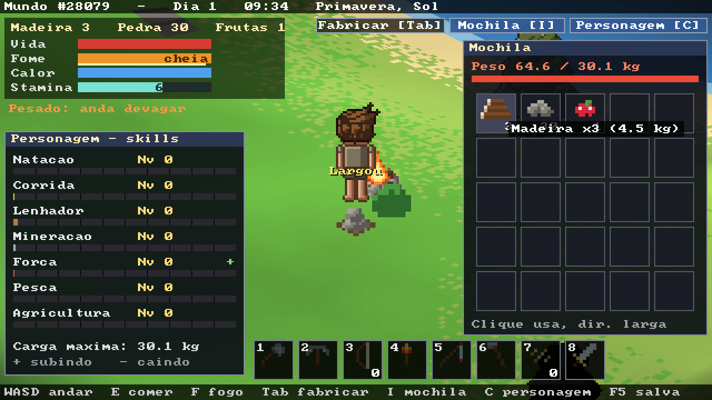

**Estações e clima**

O ano tem 4 estações de 4 dias cada (48 minutos), e o jogo começa na primavera. Dentro de cada estação, o clima muda a cada poucos minutos, sorteado do que é comum naquela época:

| Estação | Clima comum |
|---|---|
| Primavera | sol, nublado, chuva, às vezes tempestade |
| Verão | sol e calorão, às vezes tempestade |
| Outono | chuva, nublado, tempestades |
| Inverno | neve, nublado, granizo |

Depois de uma tempestade (fora do inverno), metade das vezes vem uma **enchente**. Cada clima entra e sai devagar, em uns 20 s. O nome da estação e do clima fica na barra de cima.

| Clima | Efeito |
|---|---|
| Sol | normal |
| Nublado | um pouco mais escuro |
| Chuva | esfria, a fogueira queima 2x mais rápido, enxerga menos; frutas voltam 2x mais rápido |
| Tempestade | escuro, relâmpagos, esfria bastante, fogueira queima 4x mais rápido, enxerga bem menos, mais lento e cansa mais |
| Calorão | esquenta (até de noite), 2x mais fome, cansa 50% mais e recupera a stamina pela metade |
| Neve | frio forte até de dia, anda 20% mais devagar, mais fome |
| Granizo | machuca fora do abrigo ("Granizo: perdendo vida!") |
| Enchente | a água sobe até 120: praias e campos baixos viram água rasa ou funda por uns 4 minutos e depois baixam; fogueiras alagadas apagam |

O **abrigo** protege do frio do clima e do granizo.

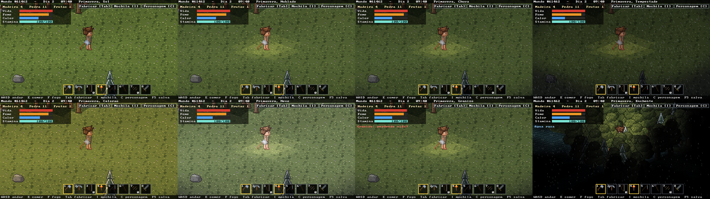

**Água**

| Nível | Onde | O que acontece |
|---|---|---|
| **Rasa** | beira de lagos e praias | anda um pouco mais devagar |
| **Funda** | meio dos lagos e do mar | nada (mais devagar ainda), gasta **stamina** e esfria. Sem stamina, quase não sai do lugar e começa a se afogar |
| **Mar aberto** | água muito funda perto das bordas do mapa | aviso de tubarão; uma barbatana começa a rodear e chega mais perto. Em 7 segundos ele ataca |

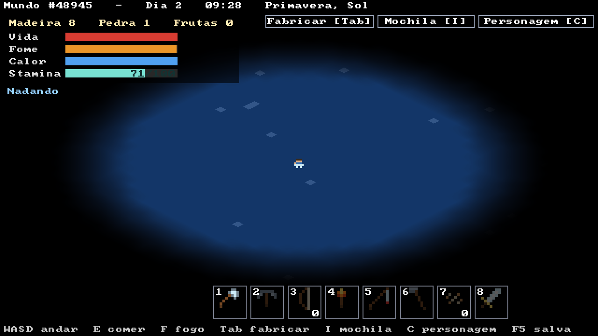
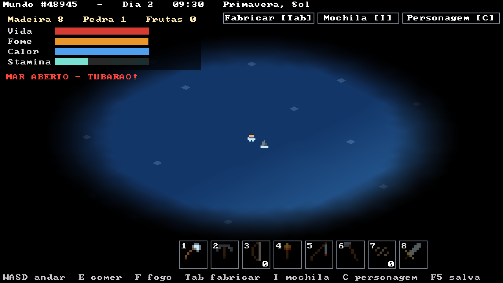

**Neblina de guerra**

- O mapa começa todo **preto**: você descobre andando.
- O personagem enxerga até **15 células de dia** e **5 de noite** (diminui aos poucos no entardecer). Fogueiras acesas também revelam em volta.
- **Árvores tapam a visão**: dentro da floresta você enxerga bem menos.
- O que você já viu mas não está vendo agora aparece **escurecido e sem cor**, do jeito que estava da última vez. Um arbusto que voltou a dar frutas longe dos seus olhos continua aparecendo vazio até você voltar lá.

## Salvar e carregar

- **F5** salva tudo num arquivo só, `ermo.sav`, na pasta de onde o jogo foi aberto: você (vida, fome, mochila, skills, ferramentas), a hora, o dia e o clima, o que mudou no mundo (árvores cortadas, pedreiras, terra arada, estradas, plantas, cercas, construções, baús e pilhas no chão), o que você já viu e os animais. Não dá para salvar morto nem dormindo.
- **F9** carrega o último jogo salvo, a qualquer hora (e depois de morrer).
- Ao abrir o jogo, se tiver um `ermo.sav`, a tela de título já mostra o mundo dele: **ENTER** (ou **C**) continua. **N** começa um jogo novo nesse mundo e **R** sorteia outro mundo.
- O relevo sai da semente do mundo, então o arquivo guarda só o que muda (uns 1,5 MB). O `ermo.sav` da versão com a vila não abre mais (o jogo avisa).

## Desafio

O mundo é difícil de propósito: comida é pouca e estraga, o inverno pesa e as noites são perigosas.

- **Comida estraga:** carne e peixe crus perdem um quarto a cada 6 horas de jogo (em 1 dia, de 8 sobram 3), frutas a cada 12 horas, assados a cada 18 horas. No seu **baú** estraga na metade da velocidade; nas pilhas no chão, mais rápido na chuva. Pão, trigo e sementes não estragam. Quando algo estraga na sua mochila, aparece "Estragou: ...".
- **Fome mais rápida**; no inverno, 25% mais.
- **Pouca comida no mundo:** poucos arbustos (que demoram dias para voltar e não dão no inverno), pouco trigo selvagem, o trigo plantado cresce mais devagar e só na primavera e no verão. É preciso guardar comida (pão dura) antes do outono.
- **Inverno duro:** mesmo de sol, fora do abrigo e longe do fogo o calor cai devagar (de noite, depressa); a roupa de couro corta pela metade. Quase não aparecem bichos de caça.
- **Noites perigosas:** a partir do 2º dia, ao escurecer (20:24), pode vir uma **alcateia** atrás de você: chance de 25% + 10% por dia (+30% no inverno), com 2 lobos + 1 a cada 3 dias (até 6; +1 no inverno). Ela aparece a 22 células e vem direto para você. O fogo e o abrigo protegem; às 06:00 os lobos que sobraram vão embora.
- **Pedreiras e minas** em manchas de várias células; cada célula que acaba vira buraco.

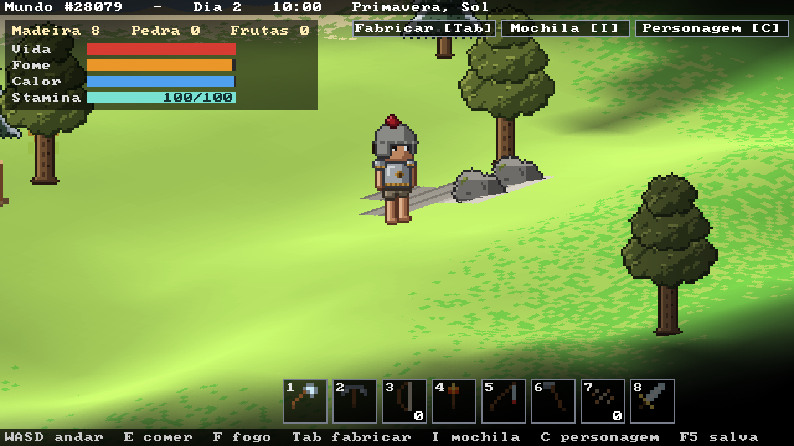
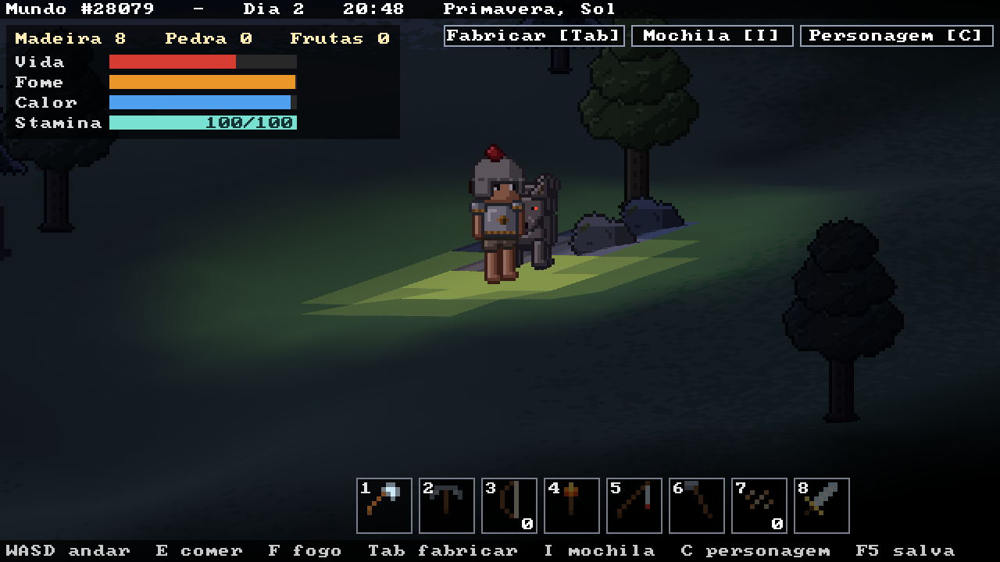

## Como funciona

| Arquivo | O que tem |
|---|---|
| `comum.h` | macros e constantes compartilhadas |
| `ermo.S` | janela, entrada, geração do mundo, terreno (e a terra arada), árvores |
| `sobrevivencia.S` | personagem, coleta, mochila, skills, fabricar, baús, abrigos, fome, calor, fogueiras, água, noite e interface |
| `clima.S` | estações, sorteio do clima, efeitos, chuva/neve/granizo, cor do clima e relâmpago |
| `animais.S` | animais (aparecer pelo terreno, fugir, perseguir, morder), flechas e golpes |
| `cercas.S` | cercas e portões: grade de colisão, fileira travada em 8 direções, grade e prévia na tela, trocar cerca por portão |
| `pesca.S` | vara de pesca: lançar, boia, mordida, fisgar, tipo de peixe pela água |
| `plantacao.S` | trigo selvagem, enxada, sementes, crescimento (água, clima, estação), colheita e bichos que comem a plantação |
| `ferro.S` | fornalha e lampiões |
| `desafio.S` | pedreiras e minas, comida que estraga, manadas e as alcateias da noite |
| `salvar.S` | salvar e carregar o jogo (F5 / F9) e o "continuar" da tela de título |
| `personagens.S` | os desenhos do personagem (e dos moradores da vila antiga) em 8 direções e 3 poses (gerado por `arte/personagens.py`) |
| `nivel.S` | nível e XP: a curva 1,5x, subir de nível, o teste |
| `heroi.S` | desenha o herói camada por camada (corpo, cabelo, botas, peitoral, capacete, espada) pela direção e pelo quadro |
| `c/` | **código em C** (o jogo está migrando de assembly para C aos poucos): `ermo.h` (base: o estado `G`, que o registrador x28 aponta, e `ASM(nome)` para chamar o assembly), `ermo_equ.h` (as constantes do assembly, geradas por `arte/equ2h.py`), `inimigos.c` (XP dos bichos), `nivel.c` (a curva de XP), `movimento.c` (clicar para andar, ir até o inimigo, segurar para atacar), `alvo.c` (o bicho sob o mouse pelo desenho). Compilado com `-ffixed-x28` para não mexer no x28; o assembly chama funções em C com `bl F(nome)`. |
| (estilo 2) | `arte/pixel.py` entende `"densidade": 2` no json: cada quadro tem o dobro de pixels e vem com uma cópia pela metade; o jogo desenha a metade da escala (zoom par) ou a cópia (zoom ímpar), e o chão vira 64 × 32 (`TL_D` no `pixel.h`). `python3 arte/pixel.py --dobro ...` amplia a arte de hoje 2× para testar: o jogo sai igual. `ERMO_SEED=123 ./ermo` sempre gera o mesmo mundo. |
| `pixel.S` | os desenhos em pixel art do designer: herói em camadas, lobo, árvore, pinheiro, pedra, tocha e penhasco e as imagens da interface da fase 1 (janela C, botão +, ícones, barras de XP) e o efeito de subir de nível; o lobo e o urso animados e as sombras. Gerado por `arte/pixel.py` a partir do `design/estilo/designer/ermo_estilo.json`, do `design/fase1/designer/ermo_fase1.json` e do `design/fase2/designer/ermo_fase2.json`; paleta em `pixpal.inc`, áreas da janela em `pixel.h` |
| `pilhas.S` | pilhas de itens no chão: que item é, quanto cabe, comida que estraga no chão |
| `construcoes.S` | escolhe o desenho de cada construção (aberto/fechado, aceso/apagado, vizinhos, tamanho da pilha) e as cinzas da fogueira |
| `estruturas.S` | os desenhos das construções, pilhas e estrada (gerado por `arte/estruturas.py` a partir do `design/estruturas/estruturas.json`) |
| `estradas.S` | estradas: colocar e desfazer |
| `intel/instalar.sh` | prepara um Ubuntu x86-64 para rodar o jogo emulado (QEMU) |

- **Geração:** ruído fractal num mapa de altura de 512x512, só com aritmética inteira. A mesma semente sempre gera o mesmo mundo.
- **Terreno contínuo ("voxel space" isométrico):** cada coluna da tela anda pelo mundo de frente para trás e pinta só o que fica visível. As 1280 colunas são divididas entre **8 threads**, uma para cada núcleo.
- **Objetos com z-buffer:** árvores, pedras, arbustos, fogueiras e o personagem respeitam a profundidade do terreno.
- **Visão:** a cada quadro saem 360 raios do personagem e de cada fogueira. Cada raio perde transparência ao passar por células com árvores. O resultado vai para dois mapas: "vendo agora" e "já visto". Cada objeto guarda também o estado em que foi visto por último.
- **Neblina e noite:** depois de desenhar o mundo, cada pixel descobre a que ponto do mapa pertence (pelo z-buffer), lê os dois mapas com interpolação suave e escurece/descolore o que não está à vista; de noite multiplica pela luz ambiente mais a luz das fogueiras. Essa passada também roda nas 8 threads.
- **Interface:** botões, janelas e ícones são desenhados com retângulos pelo SDL; os ícones da mochila são os mesmos sprites das pilhas no chão.
- **Clima:** a chuva, a neve e o granizo são partículas sem estado: a posição de cada uma sai de um hash do seu número e do quadro atual, então não precisa guardar nada. A cor do clima é misturada em cada pixel na proporção do brilho dele (a neblina preta continua preta), nas 8 threads. Na enchente, o terreno abaixo do nível da água é desenhado como água na superfície.
- **SDL3** só abre a janela, lê teclado e mouse e mostra o framebuffer na tela.

## Compilar e rodar (macOS com Apple Silicon)

```sh
xcode-select --install     # se ainda não tiver as ferramentas da Apple
brew install sdl3
make run
```

## Compilar e rodar (Linux ARM64)

```sh
sudo apt install libsdl3-dev   # ou compile o SDL3 a partir do código-fonte
make run
```

## Jogar num Mac Intel (ou PC Intel/AMD)

O Ermo é assembly ARM64, então num processador Intel ele roda **emulado**: um Ubuntu numa máquina virtual e, dentro dele, o QEMU traduzindo o ARM64. Fica mais lento que no Mac com chip M; por isso começa no **modo leve** (F10 liga e desliga). Dê à máquina virtual o máximo de núcleos que puder: o jogo desenha em 8 threads.

1. Instale o [UTM](https://mac.getutm.app) (grátis) e baixe o **Ubuntu 24.04 Desktop** (amd64) em [ubuntu.com/download/desktop](https://ubuntu.com/download/desktop).
2. No UTM: **Create a New Virtual Machine → Virtualize → Linux**, escolha o ISO do Ubuntu, dê **4 GB** de memória ou mais, **todos os núcleos menos 1 ou 2** e uns **25 GB** de disco. Instale o Ubuntu normalmente.
3. No Ubuntu, abra o Terminal e rode:

```sh
sudo apt install -y git
git clone https://github.com/pascalfuentes/trilhos.git ~/trilhos
bash ~/trilhos/intel/instalar.sh
```

O script (`intel/instalar.sh`) liga os pacotes arm64 do Ubuntu, instala o QEMU e o compilador ARM64, compila o SDL3 para ARM64 (janela X11) e o jogo, e cria o `~/trilhos/jogar.sh` e o atalho **Ermo** nos aplicativos. Para jogar: `~/trilhos/jogar.sh`. Para atualizar depois: `bash ~/trilhos/intel/instalar.sh --so-jogo`.

O tempo do jogo anda por quadro: se a máquina virtual desenhar menos de 60 quadros por segundo, o dia passa mais devagar.

`./ermo --shot` roda sem interação: tira screenshots, mede o tempo de cada quadro e faz um teste automático (coleta duas árvores, uma pedra e um arbusto, monta uma fogueira, come e passa a noite; corre, anda carregado, larga e recolhe uma pilha de pedras, vê a skill cair sem treino, confere que a vida só sobe com a fome cheia; fabrica tudo, monta baú e abrigo, gasta o machado, acende a tocha à noite, passa a noite no abrigo e dorme das 22h às 06h; passa 10 s em cada um dos 8 climas (com foto); caça um cervo com o arco, enfrenta um lobo à noite com o machado e vê os animais aparecendo; faz um cercado e pesca; ara e planta 6 células perto da água, colhe o trigo maduro, confere que o verde não sai e que a enxada desfaz a terra (e perde a semente), faz pão, compara o crescimento com e sem água e no inverno, e solta um coelho perto do trigo sem cerca; tenta quebrar um veio sem picareta, minera ferro e carvão, monta a fornalha, faz 18 barras, carvão de madeira, ferramentas, espada, armadura e um lampião, compara o machado de pedra com o de ferro e deixa um lobo morder com armadura (foto de noite na fornalha); conta pedreiras, minas, arbustos e trigo, esgota uma pedreira (foto), deixa 8 carnes cruas 1 dia na mochila, passa 10 s de sol no inverno, solta uma manada de cervos e confere que fica junta e, de noite, solta uma alcateia de 4 lobos e confere quantos chegaram até você (foto); salva o jogo, bagunça o dia, onde você está, um baú, a mochila e os objetos, carrega de volta e confere que tudo voltou; arrasta 6 estradas e desfaz uma com a enxada; depois nada num lago e vai para o mar aberto até o tubarão atacar). O teste sorteia um mundo novo a cada vez, então alguns números mudam de uma rodada para outra (e, num mundo sem água perto, a pesca pode não achar onde lançar).

`./ermo --novo` começa um jogo novo como o jogador começaria (sem os atalhos do teste), salva a foto dos primeiros 10 s (`shot_novo.bmp`), deixa o tempo correr 2 dias sem tocar em nada e diz o dia e se você morreu (parado, sem fogo, a noite costuma matar).

## Próximos passos

- [x] Fabricar: machado, picareta, tocha, baú, abrigo, cesto, frutas assadas
- [x] Minérios (ferro, carvão), fornalha, ferramentas de ferro, espada, armadura e lampião
- [x] Animais e caça (arco, flechas, carne, couro)
- [x] Pesca e plantação (trigo, enxada, sementes, pão)
- [x] A vila (até a etiqueta `vila`): famílias, fé, tarefas, zonas, casas, depósitos, soldado e pescador
- [x] Mundo mais difícil: pedreiras, comida que estraga, manadas, inverno duro e alcateias
- [x] Salvar e carregar o jogo
- [x] Construções novas do designer e estradas de pedra
- [x] RPG, fase 0: a vila saiu (o jogo começa com você sozinho)
- [x] RPG, fase 0.6 (parte 1): herói, lobo, árvores e pedras do designer, zoom inteiro e luz por bloco
- [x] RPG, fase 0.6 (parte 2): o chão em losangos do designer
- [x] RPG, fase 1.1 e 1.2: nível, barra de XP e a curva 1,5x
- [x] RPG, fase 1.3 e 1.4: atributos e 5 pontos por nível
- [x] RPG, fase 1.5 e 1.6: vida pela Vitalidade, mana pela Energia; o save já guarda tudo
- [x] RPG, fase 2.1: bichos com nível (vida, mordida e defesa)
- [x] RPG, fase 2.2: nível pela região
- [x] RPG, fase 2.8 e 2.9 (parte 1): sombras; lobo e urso animados do designer
- [x] RPG, fase 2.4: barra do inimigo no topo
- [x] RPG, fase 2.5: grupos, campeões e chefes
- [x] RPG, fase 2.3: XP pelo nível do bicho
- [x] RPG, fase 2.6 e 2.7: noite +2 níveis; invasões de elite (fase 2 completa)
- [x] Estilo 2, etapa 0.7 (motor): arte com o dobro de detalhe (densidade 2)
- [ ] Estilo 2: trocar a arte quando o pedido 0.7 do designer voltar
- [x] Migração para C, etapa 1: C e assembly no mesmo executável (primeira função: XP dos bichos)
- [x] RPG, fase 1.8: curva de XP nova (10 no primeiro nível, ×1,25), em C
- [x] RPG, fase 3.1 a 3.3: clique esquerdo anda até o ponto; clique no inimigo vai até ele e ataca; segurar continua atacando; zona de clique pelo desenho (em C)
